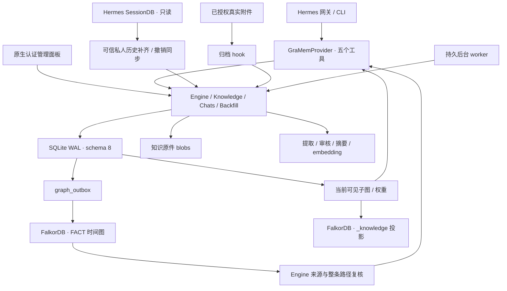

# GraMem 架构与源码结构

适用于 **GraMem 2.5.0 / SQLite schema 8 / 面板 1.8.1**，核对日期 2026-10-14，Asia/Singapore。

GraMem 实现 Hermes 原生 MemoryProvider。SQLite 是事实、来源、排除、任务、聊天原件与文档元数据的事务边界；FalkorDB 保存独立时间关系和记忆网投影；知识库文件原件保存于私有 blobs。认证面板与后台 worker 共用 Engine 和 Store。

## 模块责任

| 路径 | 责任 |
|---|---|
| `__init__.py`、`plugin.yaml`、`pyproject.toml` | 原生目录发现、显式注册、entry point、版本与依赖 |
| `gramem/hermes.py` | 实际作者、宿主回调、五个工具、控制意图与防绕过 hook |
| `gramem/config.py` | Config 校验、Owner / Contact / Group、可信 aliases |
| `gramem/engine.py`、`gramem/store.py` | 事实、来源、召回、排除、事务、迁移、跨进程锁与备份 |
| `gramem/evidence.py` | 宿主与历史导入共用的规范用户证据 |
| `gramem/knowledge.py`、`gramem/knowledge_gateway.py` | 原件、版本、解析/OCR、分块、向量、原生附件授权 |
| `gramem/chats.py`、`gramem/chat_import.py` | 不可变聊天原件、摘要、策略复核、只读 SessionDB 补齐与撤销同步 |
| `gramem/chat_backfill.py` | 当前私人身份的历史批量任务、截止时间、游标与双层租约 |
| `gramem/relations.py` | 有效事实关系后台补齐、300 秒租约、证据/版本/排除复核 |
| `gramem/identity_migration.py` | 管理员离线迁移已核实 Contact 到 Owner，不绕过禁提/撤销 |
| `gramem/chat_audio.py` | 助手音频关联、原件/hash、导出和恢复 |
| `gramem/network.py` | 当前可见记忆网、来源导航、事件、权重与独立图发布 |
| `gramem/approval.py`、`gramem/reflection.py` | 候选自动审核、同槽整理、有来源画像与周期任务 |
| `gramem/model.py`、`gramem/graph.py`、`gramem/tokens.py` | 模型/图通信与预算估算 |
| `gramem/documents.py`、`gramem/migrate.py`、`gramem/cli.py` | 文件兼容入口、旧数据迁移与可信本机管理 |
| `integrations/control-panel/` | 面板 API 与 dashboard/dist 运行静态资源的唯一主源码 |
| `compose.yaml`、`deploy/gramem/` | 独立 FalkorDB 定义 |
| `scripts/`、`tests/v2/`、`docs/` | 实例操作、行为验证、现行手册与历史证据 |

## 数据与权威来源

| 表 / 存储 | 内容 |
|---|---|
| `memories` | 事实、版本、生命周期、时间、来源、向量与 embedding 空间 |
| `sources`、`source_turns` | 提取任务及诊断；身份/session/原始 turn 到 source 的无正文映射 |
| `exclusions` | principal + slot 的停用/删除及策略 epoch |
| `events`、`receipts`、`checkpoints`、`meta` | 审计、交付去重、压缩证据与缓存 revision |
| `profiles`、`graph_outbox` | 来源约束的画像、可重放图同步命令 |
| `knowledge_documents`、`knowledge_chunks` | 文档家族/版本、hash、处理租约、分块到 memory 的映射与页码 |
| `knowledge/blobs/<prefix>/<id>.blob` | 原始文件字节；目录 700、文件 600，原子保存 |
| `chat_turns`、`chat_summaries` | 双方原话、不可变 JSON 原件/hash、来源、策略 epoch、摘要与证据 |
| `chat_native_state` | 档案关联的原生用户行及整个归档单元的有效状态 |
| `chat_audio`、`chats/audio/<prefix>/<id>.blob` | 所属聊天/身份、TTS 文案及调用来源、音频 MIME/hash/大小/状态；不可变音频字节 |
| `chat_backfill_jobs`、`chat_backfill_items` | 私人历史任务、截止时间、游标、去重目标和任务租约 |
| `knowledge_network_state` | 各身份记忆网投影的同步 revision 与刷新时间 |
| FalkorDB FACT / `_knowledge` | 有来源的时间关系 / 当前允许发布的历史导航投影 |

Store 支持新库（user_version 0）与 schema 2–8，事务迁移到 8；不接受 schema 1 或未知版本。FTS5 使用中文 bigram，向量绑定模型/维度/revision。Hermes `state.db` 与 GraMem `memory.sqlite` 是两个数据库；Context Engine 的 `context-selector/index.sqlite` 又是独立索引，不能把它们的 schema 编号互换。

## 处理流程

会话事实：可信实际作者 → 当前控制意图 → 有界召回 → 已完成用户原话持久入队 → 一次模型提取/冲突/关系/审批 → 重核策略 epoch、来源和目标版本 → 原子保存事实、审计及 outbox。助手回复不作事实提取证据。成功任务会清理 `sources.content`；`source_turns` 保留关联，长消息分块仍映射到原始 turn。旧来源只按身份/session/turn/规范证据的确切哈希关联。

文件：授权上传/真实附件 → principal 内字节去重和同名版本 → 原件 fsync/原子落盘 → queued → 租约解析文本/PDF/DOCX/OCR → 重核授权与租约 → 无衰减知识分块 → 逐块 embedding。新版本成功后旧分块进入历史；失败保留旧可用索引，过期 worker 不能复活旧版本。文件导入不自动抽取图关系。

聊天：主用户完成轮次 → 原话与 JSON/hash 归档 → 同身份/会话小批整理 → 有原文证据的主题/时间线 → 可见记忆网。历史批量任务先按原生消息 ID 分页补齐启动前的私人记录，再整理未完成记录；不会将已归档旧聊天重新提取为当前事实。已完成/受保护条目计入完成，缺少模型时等候。

原生撤销：每次可信历史扫描同时复核既有档案，独立于批量游标。用户、助手和下一轮边界采用 `active=1 OR compacted=1`；原件中任一原生行失效/缺失会隐藏整个单元，保留原件/hash，并使摘要、关联事实、派生、画像及图失效。旧 provider 档案没有原生行 ID 时，在本轮内按准确回复文本检测仅撤销助手的情况。同步在后台扫描发生时生效，通常一分钟，两个数据库没有跨库即时事务。

召回：scope/状态/时间/排除/聊天来源有效性 → FTS/向量候选 → 有界双向图邻域 → 整条路径来源复核 → ID 去重和统一评分 → 同预算交付 → 实际交付强化。默认总预算 1024，自动图两跳、最多 3 条、256 子预算。记忆网查询从 SQLite 重建可见子图，移除隐藏节点后才遍历；权重使用本体及关联记忆，`NEXT` 仅表示时间顺序。

## 身份、并发与维护边界

各 Hermes profile 使用独立 SQLite 和附加 home SHA-256 后缀的图 namespace。身份来自可信 transport、实际作者与管理员核实的 aliases；共享会话不能读私人库。`capture_owner_in_groups` 只采集已核实 Owner 到私人范围，共享事实须 Owner 显式提交允许的类型及 `group_safe=true`。附件 hook 重新验证 native 授权及真实缓存；helper 缺失则跳过。

模型、OCR 和图调用在事实写事务外完成；提交重核 epoch、版本、租约与 attempts。后台任务可恢复，过期调用不能覆盖接管者。面板分页的 blocked 递归集合纳入聊天状态、策略 epoch、原生失效以及派生链，total 与分页内容共用过滤。

遗忘清除当前 GraMem 原件、值/向量、派生与画像，图删除通过 outbox 完成；停用保留字节但阻断使用。deleted 不能 reactivate，reauthorize 仅允许未来新资料。上述操作不擦除 Hermes 历史、当前上下文、日志、已导出副本及旧备份。schema 8 回退须恢复匹配代码和数据库，见[部署](docs/deployment.md)与[维护](docs/maintenance.md)。

向量与图适用于个人规模：线性候选、有限路径与快照上限，实体别名不自动合并。cl100k_base 为估算预算，API embedding 向服务商发送所选文本。图片支持原件与 OCR，自动视觉描述/以图搜图未实现。历史设计输入见[原始设计](docs/original-memory-design.md)，当前操作从[文档索引](docs/README.md)开始。

## 当前后台扩展（2026-10-14）

关系补齐由知识 worker 每轮处理一条有效 active 事实；状态位于 metadata.relation_extraction，revision=1 含无关系判定，retry_at 为 300 秒租约/退避。已有关系保留，端点名称须有事实/证据原文依据；模型返回后重核版本、来源和排除 epoch，经 graph_outbox 发布。不会从共同出现推断关系，失败不阻断其他工作。详见[关系补齐](docs/relationship-enrichment-20261013.md)。普通 CLI worker/knowledge-worker 的处理范围以 cli.py 为准，不自动等同于实例 worker 的所有扩展。

Telegram 已纳入可信历史导入；长原话工具读取采用 start/next 字符分页。账号关联只改变解析，不迁移旧 Contact 数据；迁移通过 identity_migration 的受控管理员流程完成，保留证据/ID/hash 和排除。

图持久化采用固定 v4.12.0、EFFECTS_THRESHOLD 0 和有限日志轮转，两个 Compose 定义保持一致；活动配置以部署的 compose 目录为准，不以旧插件包副本为准。故障取证和回放流程见系统盘修复。
